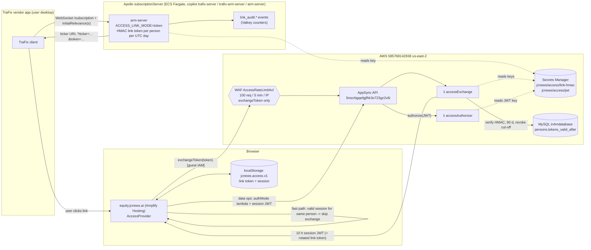

# equity.jcnews.ai Secure Link Access: System Documentation

Status: **in production and working** (rolled out the night of 2026-10-20; confirmed working by Michael on 2026-10-28).
Owner: Michael White. Last updated: 2026-10-28.

> This document contains **no secret values, tokens or full links**. Identifiers and states below were verified read-only against the code and AWS on 2026-10-28. Any item still marked **(verify)** is open.

---

## 1. Overview and goals

Before this project, anyone could open `https://equity.jcnews.ai/?ticker=…&email=…` and see a person's news view by typing an email address into the URL. The email in the URL was not used for identity, and nothing checked who was opening the page.

Goals (phase 1, browser UI):
- Only people who open a ticker from the vendor application (**TraFix**) land signed in on equity.jcnews.ai.
- No change to the TraFix client (it has a 6‑month release cycle), so no vendor API key.
- No passwords and no email delivery of links. Links reach users **only** through TraFix, via the Apollo subscriptionServer.
- Nothing stored per token (stateless), with per-person revocation and an emergency global kill switch.
- Monitoring for link harvesting, because issuance cannot be authenticated.

Out of scope (deferred to **phase 2**): locking down the AppSync API itself (guest IAM access to reader operations and `publishNewArticle`). See section 10.

## 2. Architecture and flow



Step by step:
1. **TraFix → Apollo.** TraFix connects to Apollo (`api.jcnews.ai`, path `/subscription`) with the user's email, via the `subscribeToSymbols` WebSocket subscription and the `initialRelevance` / `initialRelevances` queries. `openConnection` auto-creates unknown persons.
2. **Apollo issues the link.** In `token` mode Apollo appends `&token=<today's token>` to each ticker URL: `https://equity.jcnews.ai/?ticker=AAPL+US&token=<payload>.<sig>`. There is no `&email=` any more. The token is computed in-process, memoized per person per UTC day (`DailyTokenCache`), and never stored in Valkey, MySQL or logs. Each first issuance per (connection or IP, person, day) emits a `link_audit.issued` event.
3. **Browser opens the link.** `AccessProvider` reads `?token`, strips it from the address bar with `history.replaceState` (the ticker stays) **before any network call**. `Referrer-Policy: no-referrer` is set.
4. **Fast path (added in `7336b29`).** If the browser already holds a valid, unexpired session for the **same person** as the incoming token, the exchange is skipped and the page renders at once. "Same person" means the person id decoded (not verified) from the payload of the incoming link token equals the person id decoded from the stored link token (`linkTokenPersonId` in `src/access/accessSession.ts`). The skip also requires the stored session to have more than 300 s left and the stored link token to be unexpired; otherwise the normal exchange runs. Decode-only is safe because the stored session was verified when it was issued.
5. **Exchange.** Otherwise the browser calls the AppSync mutation `exchangeToken(token)` with guest IAM, through the WAF rate limit. `accessExchange` checks the token (format, known kid, constant-time HMAC, issue day not in the future, `now < issue day 00:00Z + 90 d`), then does **one** `persons` read (person exists, `issue day ≥ tokens_valid_after`). It returns a 10‑hour session JWT, plus today's token if the presented one is older than 60 days (silent rotation).
6. **Data calls.** Every data request uses `authMode: 'lambda'` with the session JWT. `accessAuthorizer` verifies signature, `iss`/`aud`, and `exp` only (no DB call) and returns `resolverContext {email, personId, allowedSources, department}`, cached up to 300 s. The news handlers take the email and sources from `resolverContext`, never from client arguments.
7. **Renewal.** A timer renews 2 minutes before the session expires (also on tab-visible and network-online) by re-exchanging the stored link token. `navigator.locks` serializes renewals across tabs.

Failure screens:
- Expired, revoked or invalid token: "This link is no longer valid", reopen the ticker from TraFix.
- Legacy `?email=` link: "This link format is no longer supported", reopen from TraFix. No data loads.
- A URL with **no token and no stored session** currently shows "Can't connect – Could not reach the server" (misleading; see follow-ups).

### Link token format
```
payload = "v1.<kid>.<personId>.<YYYYMMDD>"     (UTC issue day)
token   = base64url(payload) "." base64url(HMAC-SHA256(key[kid], "jcnews-link\n" + base64url(payload)))
```
- Deterministic: the same person, day and kid give the same token on every Fargate task and Lambda, so no shared state is needed.
- `linkToken.ts` is a byte-for-byte copy in both repos (`amplify/functions/access-shared/linkToken.ts` and `src/access/linkToken.ts`), enforced by a contract test and a golden vector.

### Session JWT
HS256 keyed by `jcnews/access/jwt`. Claims: `iss=jcnews-access`, `aud=equity.jcnews.ai`, `sub`=email, `pid`=person id, `src`=allowedSources at exchange time, `dep`=department, `iat`, `exp` (10 h).

## 3. Design decisions

| Decision | Choice | Why / consequence |
|---|---|---|
| Link token type | Stateless HMAC-SHA256 over person id + UTC issue day + kid | No token table, no DB write to mint; any Apollo task or Lambda computes the same token |
| Token lifetime | 90 days from 00:00Z of the issue day | Bounds a leaked or harvested link |
| Rotation | Silently replaced by today's token when older than 60 days | Users never see an expiry while they keep using it; old token stays valid to its own day 90 |
| Session | 10‑hour JWT, renewed silently | One exchange per user per ~10 h |
| Revocation latency | Up to 10 hours | The authorizer checks signature and expiry only (no DB), accepted trade-off. Emergency: rotate the JWT key |
| WAF on `exchangeToken` | 100 requests / 5 min / IP (`ACCESS_WAF_LIMIT`) | Slows token guessing; offices behind one NAT share the limit |
| Vendor key | None (`VENDOR_AUTH=off`) | TraFix runs on user desktops, so a key could not be kept secret, and the client cannot change. Code kept dormant |
| Who gets tokens | Everyone, including persons auto-created by `openConnection` | Michael's decision; new persons are alerted on (`link_audit.new_person`) |
| Email in URL | Removed; it was never used for identity | `persons.token` (base64 of email) is untouched and unused |
| Email in UI | Not shown | Michael's request (shipped in `7336b29`) |
| Header layout | Ticker search box and Sign out on one row | Michael's request (shipped in `7336b29`) |
| Fast sign-in | Skip the exchange when the browser already has a valid session for the same person | Removes the "checking your access" pause on repeat clicks (shipped in `7336b29`) |
| Sign out | Browser-only | The person's TraFix links keep working until expiry or revoke |
| Production changes | Night only | People use the system during the day; sandbox work in the daytime is fine |

### Threat model (accepted residual risk)
Without vendor authentication, anyone who finds the Apollo endpoint and knows an email address can obtain that person's ticker link and a UI session for their news view (up to 90 days or until revoked). It does **not** give write access, other persons' data, or the keys. Mitigations are detective and limiting: WAF on the Apollo ALB, `link_audit` alarms, 90‑day expiry, per-person revoke, and global key rotation. The link HMAC key is a master key: anyone holding it can mint a link for any person.

## 4. Deployed components and identifiers

AWS account `585768142838`, region `us-east-2`, CLI profile `JCNews`.

### Code and builds
| Component | Value |
|---|---|
| Amplify repo | `MichaelWhite63/jcnews-amplify` (Mac: `/Users/michaelwhite/Documents/jcnews/Amplify`) |
| Amplify app | `dd5969t12wax4`; branch `main` = production, **auto-deploys on push** |
| Amplify `main` (production) | `7336b29` (header + fast sign-in), production build job **47** succeeded (job 46 = `7174e7d`) |
| Amplify history | `714ed80` (pre-work, tag `pre-token-access-2026-10-19`) → `7174e7d` (token access incl. StrictMode fix `56a48ea`, `exchange.ok` log) → `7336b29` |
| Amplify branches kept | `feature/ui-token-access`, `fix/header-and-fast-signin` (their Amplify preview branches and backend stacks were deleted) |
| Amplify draft PR | https://github.com/MichaelWhite63/jcnews-amplify/pull/1 (left open; can be closed) |
| subscriptionServer repo | `MichaelWhite63/subscriptionServer` (Mac: `/Users/michaelwhite/Documents/jcnews/subscriptionServer`) |
| Deployed Apollo code | branch `feature/token-links`, commit **`cbfacec`** (code `7cfc2c4` + manifest variables + `copilot/arm-server/addons/link-secret-policy.yml`) |
| **Not merged to main** | ⚠️ `feature/token-links` is **not** on `main`. A deploy from `main` would remove token mode. Deploy only from `feature/token-links` until it is merged |
| subscriptionServer baseline | tag `pre-token-access-2026-10-19` = `5f71335` (old WIP on `main@a5be032`) |
| subscriptionServer draft PR | https://github.com/MichaelWhite63/subscriptionServer/pull/1 |

### Apollo (ECS Fargate)
| Item | Value |
|---|---|
| Copilot app / env / service | `trafix-server` / `trafix-arm-server` / `arm-server` |
| Endpoint | `api.jcnews.ai`, path `/subscription`; ALB `trafix-Publi-iCP9jEEh0EIt` (routes only `/subscription*`, so `/` returns 503 through the ALB, which is expected) |
| Task definition in use | revision **152** (token mode; confirmed 2026-10-28) |
| Rollback task definition | revision **151** (image digest `sha256:497ecfe4…dd9`, still in ECR repo `trafix-server/arm-server`). ⚠️ Revision 151 is **INACTIVE** (checked 2026-10-28): it cannot be used directly with `update-service`. See rollback option E |
| Environment | `ACCESS_LINK_MODE=token`, `VENDOR_AUTH=off`, `LINK_AUDIT_EMAIL=plain`, `LINK_AUDIT_MAX_EMAILS_PER_CONN=1`, `LINK_AUDIT_MAX_EMAILS_PER_IP_HOUR=50`, `LINK_AUDIT_NEW_PERSON_WINDOW_SEC=604800` |
| Secret injection | `ACCESS_LINK_SECRET` from `jcnews/access/link-hmac`; task role has `secretsmanager:GetSecretValue` on that ARN only (`link-secret-policy.yml`) |
| Valkey | `REDIS_HOST` = `nodebasedin4mvalkeycache…` (cluster-wide `ip_many_emails` counting) |
| ECS cluster / service | cluster `trafix-server-trafix-arm-server-Cluster-M14sBahGtXfN`; service `trafix-server-trafix-arm-server-arm-server-Service-0Z5iyUIXSRck` (desiredCount 0 at night, per the scheduler) |
| Task definition family | `trafix-server-trafix-arm-server-arm-server` |
| Log group | `/copilot/trafix-server-trafix-arm-server-arm-server` |
| Scheduler | Lambda `trafix-server-scheduler` via EventBridge (`infrastructure/scheduler.yml`): rule `trafix-server-start-business-hours` `cron(0 13 ? * MON-FRI *)` sets desiredCount 2; rule `trafix-server-stop-business-hours` `cron(30 21 ? * MON-FRI *)` sets desiredCount 0. It changes only the task count, so a morning start runs the latest task definition |

> Scheduler times are in **UTC**: 9:00–17:30 ET while daylight time is in effect, and **8:00–16:30 ET after clocks go back on Sun 2026-11-01** (unless the rule is changed). Apollo runs 0 tasks at night and on weekends.

### Amplify backend
| Item | Value |
|---|---|
| Production AppSync API | `5nscrbgqefgjfhk3o723gz2v6i`, endpoint host `g54zkvq6ezftzlpwy4mojsbdju.appsync-api.us-east-2.amazonaws.com` |
| Lambdas | `accessExchange` (mutation `exchangeToken`), `accessAuthorizer` (AppSync Lambda authorizer, cache TTL 300 s). Production function names: `amplify-dd5969t12wax4-mai-accessExchangelambdaF1EB-DConHJUVn37A` and `amplify-dd5969t12wax4-mai-accessAuthorizerlambda32-sqXjCp0vjZ7S`; their log groups are `/aws/lambda/<function name>`. Other `accessExchange`/`accessAuthorizer` log groups (`amplify-amplifynewsapp-mi-…`, `…-fea-…`, `…-fix-…`) belong to deleted sandbox/preview stacks and only hold old logs |
| WAF on AppSync | web ACL `AccessRateLimitAcl-935CtWIN7fWg`, attached to the production API (verified 2026-10-20); rate limit 100 / 5 min / IP, scoped to the parsed JSON `query` containing `exchangeToken` |
| Config defaults | `ACCESS_SESSION_TTL=10h`, `ACCESS_TOKEN_TTL=90d`, `ACCESS_ROTATE_AFTER=60d`, `ACCESS_AUTHORIZER_CACHE_TTL=300`, `ACCESS_WAF=on`, `ACCESS_WAF_LIMIT=100` |
| Hosting headers | `customHttp.yml`: `Referrer-Policy: no-referrer` and other security headers |
| Preview AppSync (deleted) | `6a33chbp6rd6fe5tokg3jnjwmy` (preview branch stack, removed after testing) |

### Secrets (Secrets Manager, us-east-2): names only
| Secret | Purpose | Read by | ARN suffix |
|---|---|---|---|
| `jcnews/access/link-hmac` | Link HMAC key ring `{"activeKid":"k1","keys":{"k1":…}}`, active kid **k1** | `accessExchange`, Apollo task role | `OzoN8N` |
| `jcnews/access/jwt` | Session JWT HS256 key | `accessExchange`, `accessAuthorizer` | `C44Y5n` |
| `in4m/rds/credentials` | RDS admin credentials (pre-existing) | Lambdas, scripts | n/a |
| `jcnews/access/vendor-api-keys` | Optional unused placeholder | none | does not exist (checked 2026-10-28) |
| Sandbox secrets `jcnews/access/sandbox-db`, `jwt-sandbox`, `link-hmac-sandbox` | Sandbox testing only | none in prod | gone: not listed even with planned-deletion secrets included (2026-10-28) |

### Database
| Item | Value |
|---|---|
| RDS | `production-in4m-database.cnwkqkqik0k9.us-east-2.rds.amazonaws.com`, database `in4mdatabase` |
| Migration | `amplify/db/migrations/001_persons_tokens_valid_after.sql`: `ALTER TABLE persons ADD COLUMN tokens_valid_after DATETIME(3) NULL` (additive, nullable) |
| Pre-migration snapshot | `manual-pre-tokens-valid-after-20261020-2240` |
| Unchanged | `persons.token` (base64 of email) is not used for access |

### Monitoring resources
| Type | Name | Notes |
|---|---|---|
| SNS topic | `jcnews-ops-alerts` | Email to michaelwhite63@gmail.com (subscription confirmed) |
| SNS topic | `jcnews-ops-pager` | Email to michaelwhite63@gmail.com (subscription confirmed) |
| Metric filters (Apollo log group) | `link_audit_issued`, `link_audit_new_person`, `link_audit_conn_many_emails`, `link_audit_ip_many_emails` | Namespace `JCNews/Access`, metrics `LinkAudit_<event>` |
| Metric filter (accessExchange log group) | `exchange_ok` | Metric `Exchange_ok`, namespace `JCNews/Access`; sign-in count, no alarm |
| Alarms | see section 6 | |
| WAF on Apollo ALB | web ACL `jcnews-apollo-alb`, **all rules in Count** | IP reputation, Common Rule Set, Known Bad Inputs, and two per-IP rate rules, `rate-subscription-per-ip` and `rate-initialRelevance-per-ip` (both limit **2000** per IP, all in Count; default action Allow). Rule order: `IpReputation`, `CommonRuleSet`, `KnownBadInputs`, `rate-subscription-per-ip`, `rate-initialRelevance-per-ip`. Associated with ALB `trafix-Publi-iCP9jEEh0EIt` |
| WAF logs | CloudWatch log group `aws-waf-logs-jcnews-apollo` (logging is enabled on the ACL) | |

## 5. Operations runbook

### Ground rules
- **Production changes only at night** (after the day's users are done). Daytime sandbox and read-only work are fine.
- Apollo runs **0 tasks at night** and on weekends (see scheduler above). A night-time Apollo deploy needs the service started (desiredCount 2) and then returned to 0; the morning start picks up the latest task definition.
- Never push to Amplify `main` without explicit approval: it auto-deploys production.
- Never commit `amplify_outputs.json` (it holds the production config). After `npx ampx sandbox`, run `git checkout amplify_outputs.json`.
- Never print, paste or log secret values, link tokens, session JWTs or full tokenized links.
- Deploy Apollo **only from `feature/token-links`** until it is merged to `main`.

### Revoke one person
Run from the Amplify repo:
```
cd /Users/michaelwhite/Documents/jcnews/Amplify/amplify
AWS_PROFILE=JCNews npx tsx scripts/access/access-admin.ts revoke --email <email> [--keep-today]
AWS_PROFILE=JCNews npx tsx scripts/access/access-admin.ts status --email <email>
```
| Mode | Sets `tokens_valid_after` to | Effect |
|---|---|---|
| Full revoke (default) | now | Every link of the person, **including today's**, stops working. New links from TraFix work again from the next UTC day. Use for a leaked or harvested link or an alert |
| `--keep-today` | today 00:00Z | Older links stop working; today's link keeps working |

Existing browser sessions keep working until they expire (**up to 10 hours**). For immediate global cut-off, see "Invalidate all sessions" below.
Note: persons are revoked by id; if an email matches more than one person id, check that all are covered (see follow-ups).

### Key rotation
Link key (`jcnews/access/link-hmac`), zero downtime:
1. Put a new secret version with both kids, e.g. `{"activeKid":"k1","keys":{"k1":…,"k2":…}}`, built in a subshell with `openssl rand -base64 48` and never printed.
2. Make it effective on **both** sides: restart Apollo tasks (`aws ecs update-service --force-new-deployment …`) and force a cold start or redeploy of `accessExchange`.
3. Switch `activeKid` to `k2` (again on both sides). Old `k1` tokens still verify, and exchanges rotate users onto `k2`.
4. Remove `k1` after 90 days.

Emergency, invalidate **all links**: put a new version containing only a new kid (k1 dropped), restart Apollo tasks and cold-start `accessExchange`. To undo, move the version stage back with `aws secretsmanager update-secret-version-stage`.

Emergency, invalidate **all sessions**: put a new random value in `jcnews/access/jwt` (or a key ring with a new `activeKid` and the old kid removed), then cold-start `accessExchange` and `accessAuthorizer`. Users are re-signed in silently from their stored link token.

Never delete the secrets; put new versions instead.

### Rollback (least to most drastic)
| Option | Action |
|---|---|
| A. Stop issuing tokens | Set `ACCESS_LINK_MODE=plain` in `copilot/arm-server/manifest.yml` on `feature/token-links` and redeploy. Links become `?ticker=` only. No approval needed if users cannot sign in, but report it |
| B. Revoke one person | `access-admin.ts revoke` (above) |
| C. Invalidate all links | Rotate the link kid (above) |
| D. Invalidate all sessions | Rotate the JWT key (above) |
| E. Apollo code rollback | Revision 151 is INACTIVE, so first register a new revision from it: `aws ecs describe-task-definition --task-definition trafix-server-trafix-arm-server-arm-server:151 --query taskDefinition` (strip the read-only fields: `taskDefinitionArn`, `revision`, `status`, `requiresAttributes`, `compatibilities`, `registeredAt`, `registeredBy`), then `aws ecs register-task-definition --cli-input-json …` (same image `sha256:497ecfe4…dd9`, still in ECR), then `aws ecs update-service --cluster trafix-server-trafix-arm-server-Cluster-M14sBahGtXfN --service trafix-server-trafix-arm-server-arm-server-Service-0Z5iyUIXSRck --task-definition <new revision>`. Remember the scheduler runs 0 tasks at night. From git: build tag `pre-token-access-2026-10-19` (`5f71335`) on a rollback branch and deploy |
| F. Amplify rollback | Needs a separate approval (push to `main` deploys production). Preferred: `git switch -c rollback/amplify origin/main`, `git revert` the unwanted commits, review, push to `main`. Emergency: redeploy an earlier successful job in the Amplify console (job 46 = `7174e7d`; pre-project = `714ed80`). Never force-push `main`. The `tokens_valid_after` column stays (harmless) |
| G. Apollo WAF | Rules are already in Count. If it causes trouble: `aws wafv2 disassociate-web-acl --resource-arn <alb-arn>` |

### Day-to-day checks
- A user reports "link is no longer valid": ask them to reopen the ticker from TraFix (they get today's token). If it persists, run `access-admin.ts status --email …`.
- A user reports "Can't connect": first check that the URL had a token (see known issues), then Apollo task count and the `accessExchange` logs.

## 6. Monitoring and alerts

All alerts email **michaelwhite63@gmail.com** (both SNS topics).

| Alarm | Metric (namespace `JCNews/Access`) | Condition | Topic | Meaning / response |
|---|---|---|---|---|
| `jcnews-link-conn_many_emails-HIGH` | `LinkAudit_conn_many_emails` | Sum > 0 over 60 s | `jcnews-ops-pager` | One WebSocket connection asked for links for more than one email. A real TraFix connection always carries exactly one, so treat it as harvesting: check the IP and connection in the logs, revoke affected persons |
| `jcnews-link-ip_many_emails` | `LinkAudit_ip_many_emails` | Sum > 0 over 300 s | `jcnews-ops-alerts` | One IP received links for more than 50 distinct emails in a UTC hour (counted cluster-wide in Valkey). Could be a large office NAT or enumeration; compare against known offices |
| `jcnews-link-new_person` | `LinkAudit_new_person` | Sum > 0 over 300 s | `jcnews-ops-alerts` | A link went to a person auto-created by `openConnection` in the last 7 days. Confirm the person is a real new user |
| `jcnews-link-issued-spike` | `LinkAudit_issued` | Sum over 3600 s > threshold | `jcnews-ops-alerts` | Unusual issuance volume. Threshold is **100** per hour (checked 2026-10-28), a placeholder until tuned to about 3× normal hourly volume |

State on 2026-10-28: all four `jcnews-link-*` alarms were **OK**.

Dashboard-only metric: `Exchange_ok` (successful sign-ins, from `exchange.ok` log lines). No alarm.

Useful Logs Insights queries (Apollo log group):
```
fields @timestamp, personId, email, ip, connectionId, via | filter msg = "link_audit.new_person" | sort @timestamp desc
filter msg = "link_audit.issued" | stats count_distinct(emailHash) as emails by ip, bin(1h) | stats max(emails) as peak by ip | sort peak desc | limit 50
filter @message like /token=/ | stats count()      # must be 0, in Apollo and Amplify Lambda log groups
```

## 7. Logging

### Amplify Lambdas (`accessExchange`)
| Event | Fields | When |
|---|---|---|
| `exchange.ok` | `personId`, `rotated` (boolean), `kid` only | Successful exchange |
| `exchange.denied` | `reason` only, one of `malformed`, `unknown_kid`, `bad_signature`, `not_yet_valid`, `expired`, `unknown_person`, `revoked` | Exchange refused (the caller always gets one generic "invalid" answer) |
| `exchange.rotated` | `personId` only (no token) | A token older than 60 days was replaced by today's |

`accessAuthorizer` logs `authorizer.denied` with `reason` only (`malformed`, `bad_signature`, `expired`, `wrong_audience`, `not_yet_valid`).

The Lambdas never log the link token, the session JWT or the email.

### Apollo (`link_audit.*`, JSON lines to CloudWatch)
| Event | Fields |
|---|---|
| `link_audit.issued` | `personId`, `email` (plain per `LINK_AUDIT_EMAIL`), `emailHash`, `isNewPerson`, `connectionId`, `ip`, `via` (`subscription` / `initialRelevances` / `initialRelevance`) |
| `link_audit.new_person` | same as `issued` |
| `link_audit.conn_many_emails` | `severity:"high"`, `connectionId`, `ip`, `distinctEmails`, `threshold` |
| `link_audit.ip_many_emails` | `severity:"medium"`, `ip`, `hour`, `distinctEmails`, `threshold` |

None contains the token or URL. Check: `token=` must appear **0 times** in every log group.

Known exception outside these systems: the **TraFix C# client console prints full tokenized links** (see follow-ups).

## 8. Testing done

| Stage | What | Result |
|---|---|---|
| Unit (box, 2026-10-19) | Amplify UI session logic | 16/16 pass |
| Unit | Amplify backend | 26 pass, 1 skipped (DB) |
| Integration | Amplify backend + MySQL | 27/27 pass |
| Unit | subscriptionServer | 19 pass, 2 skipped |
| Cross-system contract | Apollo token accepted by Amplify exchange; tampered, wrong key, 91‑day-old and revoked tokens rejected; 61‑day-old token rotates to Apollo's token for today; `linkToken.ts` byte-identical | **21/21 pass** (box; re-run on the Mac in prompt 5, done 2026-10-20) |
| Typecheck / build | Both repos | clean |
| Local walkthrough (Mac, docker MySQL, short TTLs) | First visit, new tab, renewal, rotation, expiry, revoke and `--keep-today`, legacy `?email=` link; logs had 0 `token=` | passed |
| Amplify sandbox (scratch DB, sandbox secrets) | Real Lambdas, authorizer and WAF; sign-in, renewal and revoke; WAF probe on `exchangeToken` returned 403s after the limit (AWS rate rules react with about a 1‑minute delay); other operations unaffected | passed; teardown confirmed 2026-10-28: no sandbox stacks, database `jcnews_access_sandbox` no longer exists (`SHOW DATABASES` lists only `in4mdatabase`), sandbox secrets gone |
| Preview branch | Old `?email=` link screen, minted link sign-in, `Referrer-Policy: no-referrer`, WAF attached; later a second preview for the header + fast sign-in change | passed; previews deleted |
| Production (2026-10-20 night) | Secrets created (kid k1), migration applied after snapshot, Amplify build succeeded (preview first), monitoring + Apollo WAF (Count) created, Apollo task def 152 deployed directly in token mode (prompts 11 and 12 combined), TraFix links carried `token=`, Michael signed in from TraFix | passed (re-checked 2026-10-28, last 7 days: `token=` matched **0** events in the Apollo log group (19,755 events scanned), `accessExchange` (60) and `accessAuthorizer` (223); the Apollo startup warning "token mode WITHOUT vendor auth" appears (10 times, once per task start), as expected with `VENDOR_AUTH=off`) |
| Production (header + fast sign-in, build 47) | No email shown, search box and Sign out on one row, repeat ticker clicks (9 tickers) without re-exchange | passed |
| Production use (through 2026-10-28) | Daily use from TraFix | working well |

Duplicate-email check on `persons`, re-run read-only on 2026-10-28 (counts only): **0** emails appear on more than one row (exact match and case/space-insensitive match), **0** surplus rows, out of 33 persons. So `revoke --email` currently covers every person id for each email.

## 9. Known issues

- **Tokenless link shows "Can't connect".** A URL with no `token=` and no valid stored session shows "Can't connect – Could not reach the server", which looks like an outage. Seen 2026-10-26 when a wrong URL string was sent. It should say the link is missing access and ask the user to reopen from TraFix.
- **TraFix C# client prints full tokenized links** to its console. Anyone seeing the screen or a screenshot sees a live link. Redact the `token=` value in the console output.
- **Dark mode button** was reported missing from the header after the rollout. In `7336b29` the toggle (`.theme-toggle`, ☀/☾) is present in the header's ticker row in `src/App.tsx`; confirm visually in production.
- **Sign-in pause** ("checking your access") on first exchange: Michael planned to time it; result **(verify)**.
- **`NoUserAgent_HEADER`**: the TraFix WebSocket sends no User-Agent and matches this Common Rule Set rule. Harmless while the ACL is in Count; it **must be excluded for `/subscription` before switching to Block**.
- **Scheduler Valkey ID mismatch**: `trafix-server-scheduler` looks for cluster ID `valkeycluster` (status not_found), but the cluster is `nodebasedin4mvalkeycache`. Predates this project.

## 10. Follow-ups

| # | Item | When |
|---|---|---|
| 1 | WAF tuning (prompt 13): exclude `NoUserAgent_HEADER` for `/subscription`; size the `/subscription` rate limit at about 2–3× the legitimate per-IP peak; move safe rules Count → Block | after 1–2 weeks of data (from ~2026-11-03) |
| 2 | Set `jcnews-link-issued-spike` threshold to about 3× baseline hourly volume; review `LINK_AUDIT_MAX_EMAILS_PER_IP_HOUR` (keep ≥ 50) | with #1 |
| 3 | Merge subscriptionServer `feature/token-links` to `main` (until then, a deploy from `main` undoes token mode) | when comfortable |
| 4 | Fix scheduler Valkey cluster ID (`valkeycluster` vs `nodebasedin4mvalkeycache`) | any time |
| 5 | Make `revoke --email` cover every person id with that email; consider a unique index on `persons.email` | optional |
| 6 | Show "link missing access" instead of "Can't connect" for tokenless URLs | small UI fix |
| 7 | Redact `token=` in the TraFix C# client console output | small fix |
| 8 | Close draft PRs https://github.com/MichaelWhite63/jcnews-amplify/pull/1 and https://github.com/MichaelWhite63/subscriptionServer/pull/1 (keep branches and tags) | optional |
| 9 | Check scheduler hours after the 2026-11-01 time change (UTC crons shift to 8:00–16:30 ET) | before 2026-11-02 |
| 10 | Catch `Unauthorized` on data calls → refresh → retry once (clock-skew edge case) | optional |
| 11 | Content-Security-Policy for equity.jcnews.ai | optional |
| 12 | **Phase 2 API lockdown** (deferred): remove `allow.guest()` from reader ops (keep on `exchangeToken`); restrict `publishNewArticle` to a dedicated IAM role for the Mac publisher; server-side subscription filters; default-deny in handlers; disable unauthenticated identities | after phase 1 is stable for several weeks |

## 11. References

- `ARCHITECTURE.md`: full phase 1 design, flows, configuration, pitfalls, phase 2 checklist.
- `SUBSCRIPTION_SERVER_CHANGES.md`: Apollo design, modes, monitoring, WAF rules.
- `TEST_RESULTS.md`, `LOCAL_TESTING.md`: test coverage and how to run local, docker and sandbox tests.
- `CLAUDE_CODE_PROMPTS.md`: the rollout prompts (0–15), including rollback (prompt 14), tuning (13) and phase 2 (15).
