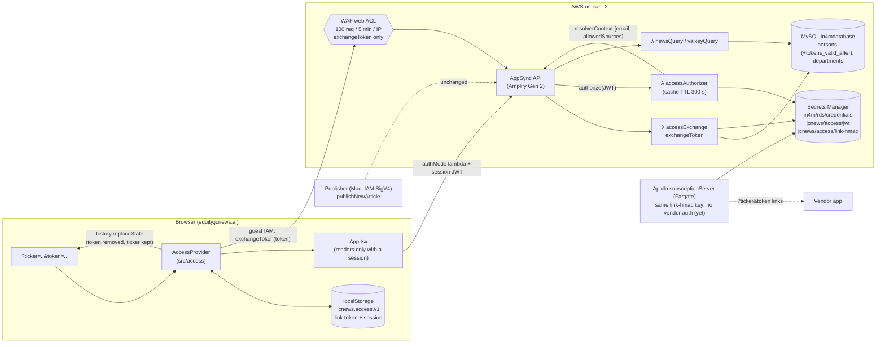
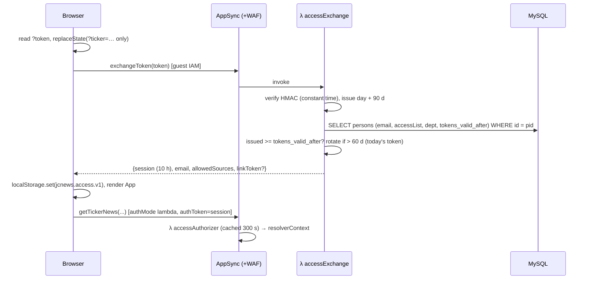

# equity.jcnews.ai — Browser access (phase 1)

Status: implemented on branch `feature/ui-token-access` (not deployed, not pushed).
Scope: **the browser UI**. Locking down the API itself (removing guest access) is phase 2. See [What remains open](#what-remains-open-phase-2).

## Summary

- Users open a **link containing a signed token**: `https://equity.jcnews.ai/?ticker=AAPL+US&token=<payload>.<sig>`. The token is a stateless HMAC-SHA256 over *person id + UTC issue day + key id*, keyed by Secrets Manager `jcnews/access/link-hmac`, a secret shared with the Apollo subscriptionServer, which builds the same tokens.
- The browser swaps the link token for a **10-hour signed session**. It does this with `exchangeToken`, an AppSync mutation callable with guest IAM and rate limited by WAF.
- Every data request carries that session (`authMode: 'lambda'`). An **AppSync Lambda authorizer** checks it.
- Server handlers take the email and allowed sources from the authorizer's `resolverContext`, never from client arguments.
- **Nothing is stored per token.** Minting is pure computation, with no DB write and no token table. Revocation is one new nullable column, `persons.tokens_valid_after`. `persons.token` (base64 of the email) is left untouched and unused.
- Link tokens can be used more than once and are valid for 90 days from their issue day. On exchange, a token older than 60 days is **silently replaced** by today's token.
- The authorizer verifies the session JWT **by signature and expiry only, with no DB call**. Revocation and accessList changes therefore take effect at the latest when the session expires (10 h). This is an accepted trade-off.
- **Links reach users only through the vendor app.** The Apollo subscription and `initialRelevances` API serve ticker links that carry today's token. Nobody is emailed: there is no `requestNewLink`, no SES and no mail code.
- Old `?email=` links, and expired or revoked links, show a screen asking the user to **reopen the ticker from the vendor application**.



## Components (files)

| Area | File | Purpose |
|---|---|---|
| Schema | `amplify/data/resource.ts` | `exchangeToken` (guest); reader ops allow `guest` + `custom`; `lambdaAuthorizationMode` (TTL 300 s) |
| Backend | `amplify/backend.ts` | Registers the 2 new Lambdas, Secrets Manager IAM, WAF web ACL + association (`ACCESS_WAF=off` disables it) |
| Lambdas | `amplify/functions/access-exchange/*`, `amplify/functions/access-authorizer/*` | Thin handlers around the shared core |
| Core | `amplify/functions/access-shared/` | `config.ts` (env durations), `linkToken.ts` (signed link tokens; **vendored byte-for-byte into subscriptionServer**), `tokens.ts` (safeEqual/normalizeEmail), `jwt.ts` (HS256 with `kid` rotation), `service.ts` (mint, exchange, rotation, authorizer, revoke), `mysqlRepo.ts`, `runtime.ts` (Secrets Manager / env wiring), `identity.ts` (read `resolverContext`) |
| Existing handlers | `amplify/functions/news-query/handler.ts`, `valkey-query/handler.ts` | When a session identity is present: email and allowedSources come from the authorizer (default deny on `[]`) |
| DB | `amplify/db/migrations/001_persons_tokens_valid_after.sql` | Additive: one nullable `persons` column |
| UI | `src/access/accessSession.ts` (logic), `AccessProvider.tsx`, `AccessScreens.tsx`, `exchangeClient.ts`, `access.css`; `src/main.tsx`; `src/App.tsx` | Gate, storage, refresh, cross-tab sync, screens, header email + Sign out |
| Hosting | `customHttp.yml`, `index.html` | `Referrer-Policy: no-referrer` and other headers |
| Ops | `amplify/scripts/access/access-admin.ts` | `mint` (one person or `--all`; `--issued` to backdate for tests), `revoke` (`--keep-today`), `status` |
| Local | `local-dev/` (docker-compose, seed), `amplify/scripts/access/dev-server.ts`, `waf-limit-test.mjs` | Local and sandbox testing |

## Link token format

```
payload = "v1.<kid>.<personId>.<YYYYMMDD>"                         (UTC issue day)
token   = base64url(payload) "." base64url(HMAC-SHA256(key[kid], "jcnews-link\n" + base64url(payload)))
e.g.      djEuazEuMTAwMS4yMDI2MTAxOQ.Di-u8gP1ODHRwlplLFgZ8B-uylnQ0fAXVhmkuGaxGCA   (golden test vector, test key)
```

- **Key ring** (`jcnews/access/link-hmac`) has the form `{"activeKid":"k2","keys":{"k1":"…","k2":"…"}}`; a plain string means `k1`. Every key must be at least 32 bytes.
  - New tokens use `activeKid`. Any listed kid verifies.
  - To rotate keys: add `k2` → make it active on **both** Amplify and Apollo → remove `k1` after 90 days. Removing a kid kills every token signed with it, which works as an emergency global revoke.
- **Verification** happens in this order:
  1. Strict regex and canonical base64url check.
  2. Known kid.
  3. HMAC compared with `timingSafeEqual`.
  4. Issue day not in the future.
  5. `now < issueDay 00:00Z + 90 d`.
  6. Then **one** `persons` read: the person exists and `issueDay 00:00Z >= tokens_valid_after`.

  Forged or garbage tokens never reach MySQL.
- **Deterministic**: the same person, day and kid always give the same token, on every Lambda and Fargate task. Apollo memoizes it per day; rotation in Amplify returns exactly the token Apollo is sending that day.
- **Revocation**: `persons.tokens_valid_after DATETIME(3) NULL`. Tokens carry only a *day*, so `revoke` (cut-off = now) also kills **today's** token, and new links work again from the next UTC day. `revoke --keep-today` (cut-off = today 00:00Z) kills older links but keeps today's.
- **Revoke default** stays *cut-off = now*. That is the stricter option, and it suits a leaked link. Use `--keep-today` when you only want older links (e.g. forwarded months ago) dead without locking the person out for the rest of the UTC day. Both behaviours are documented in the CLI output.

## Session JWT

HS256, signed with the key from Secrets Manager `jcnews/access/jwt`. The secret is either a plain string or `{"activeKid":"k2","keys":{"k1":"…","k2":"…"}}` for zero-downtime key rotation.

Claims:
- `iss` = `jcnews-access`
- `aud` = `equity.jcnews.ai`
- `sub` = email
- `pid` = person id
- `src` = allowedSources at exchange time (**trusted** by the authorizer)
- `dep` = department
- `iat`, `exp` (10 h)

The authorizer verifies **signature (pinned HS256, kid) + iss/aud + exp only**. It has no DB access: its IAM role can read only the JWT secret. It returns `resolverContext {email, personId, allowedSources (JSON string), department}` from the claims, with `ttlOverride = min(300, seconds left)`. A revoked person or an accessList change takes effect at the next exchange, at most 10 h later.

## Flows

### First visit (link from the vendor app)


### Return visit, new tab, renewal
- **Return visit or new tab (no `?token`)**: a stored session with more than 30 s left is used immediately, with no network call. Otherwise the stored link token is exchanged silently.
- **Renewal**: a timer fires 2 minutes before the session expires. It also runs when the tab becomes visible again or the network comes back. Renewal exchanges the stored link token. `navigator.locks` serialises exchanges across tabs, and other tabs pick up the new session through the `storage` event.
- On session change the App re-subscribes, so the AppSync websocket uses the new token.

### Rotation (silent)
- Exchanging a token older than `ROTATE_AFTER` (60 d) returns **today's** token, which is valid 90 d. The browser replaces its stored link token.
- No DB write. The old token stays valid until its own day 90, so link prefetchers or other devices using it are harmless and need no grace logic.
- Rotation also moves tokens onto the active `kid` after a key rotation.

### Expiry
- **Session expiry**: handled by silent renewal.
- **Link token expiry** (90 d after the issue day): the exchange returns `invalid`. The browser clears storage and shows **"This link is no longer valid"** with the instruction to reopen the ticker from the vendor application. The vendor's next link carries today's token.
- If the URL token is dead but this browser still has valid stored credentials, those are used instead.

### Revocation
- `access-admin.ts revoke --email a@x.com [--keep-today]` sets `persons.tokens_valid_after`.
- Exchanges of older tokens fail immediately.
- **Existing sessions keep working until they expire (≤ 10 h)**, because the authorizer does no DB check. This is accepted. For an emergency, rotate the JWT key (`activeKid` → new key, drop the old one), which kills every session.
- Deleting a person makes their tokens fail at exchange (`unknown_person`).

### Legacy `?email=` links
- The email is removed from the address bar and the screen reads "This link format is no longer supported", asking the user to reopen the ticker from the vendor application.
- No data loads, so the UI denies by default.

### Cutover
See `SUBSCRIPTION_SERVER_CHANGES.md` (deliverables) for the full cross-system order. For Amplify:
1. Run `001_persons_tokens_valid_after.sql` on RDS. It is additive and nullable.
2. Create the secrets. They hold random values; never paste them into chat or tickets.
   - `aws secretsmanager create-secret --name jcnews/access/jwt --secret-string "$(openssl rand -base64 48)" --region us-east-2`
   - `aws secretsmanager create-secret --name jcnews/access/link-hmac --secret-string "{\"activeKid\":\"k1\",\"keys\":{\"k1\":\"$(openssl rand -base64 48)\"}}" --region us-east-2`
3. Deploy the branch (merge to `main`). Reader ops still accept guest access, so the old UI keeps working during the deploy.
4. Links reach users through the Apollo subscriptionServer (vendor app) in `token` mode. `access-admin.ts mint` exists for support and testing only.
5. From then on, old `?email=` links show the reopen-from-vendor screen.

## Configuration

These are read at deploy time from the shell (sandbox) or from Amplify console environment variables (pipeline), and passed to the Lambdas.

| Variable | Default | Meaning |
|---|---|---|
| `ACCESS_SESSION_TTL` | `10h` | Session JWT lifetime |
| `ACCESS_TOKEN_TTL` | `90d` | Link token validity from its UTC issue day (≥ 1d) |
| `ACCESS_ROTATE_AFTER` | `60d` | Replace a token older than this on exchange (< TOKEN_TTL, ≥ 1d) |
| `ACCESS_AUTHORIZER_CACHE_TTL` | `300` | AppSync authorizer cache |
| `ACCESS_APP_BASE_URL` | `https://equity.jcnews.ai` | Base for links printed by the admin CLI |
| `ACCESS_DB_SECRET_NAME` | `in4m/rds/credentials` | DB secret (use a separate one for sandboxes) |
| `ACCESS_JWT_SECRET_NAME` | `jcnews/access/jwt` | JWT key secret (exchange + authorizer) |
| `ACCESS_LINK_SECRET_NAME` | `jcnews/access/link-hmac` | Link HMAC key ring (exchange only; shared with Apollo) |
| `ACCESS_WAF` | `on` | `off` skips the web ACL (cheaper sandboxes) |
| `ACCESS_WAF_LIMIT` | `100` | Requests per 5 min per IP for `exchangeToken` |
| Local only: `ACCESS_DB_HOST/PORT/USER/PASSWORD/NAME`, `ACCESS_JWT_SECRET`, `ACCESS_LINK_SECRET` | | Override Secrets Manager for scripts, tests and the dev server |
| Vite dev only: `VITE_ACCESS_DEV_API`, `VITE_ACCESS_DATA_AUTH=iam` | | Use the local dev server; ignored in production builds |

Durations accept `ms|s|m|h|d` or bare seconds.

## Threat model: link issuance

**Without vendor auth, anyone who finds the Apollo endpoint and knows an email address can obtain that person's ticker link, and with it a UI session.**

Why:
- The vendor app cannot send credentials (its client release cycle is out of scope), so Apollo trusts the email it is given.
- `openConnection` even auto-creates unknown persons, and the user has decided those get links too.

What it exposes:
- That person's news view (allowed sources) for up to 90 days, or until revoked.
- It does not expose write access, other persons' data, or the keys.

Mitigations (detective and limiting, not preventive):
- **AWS WAF on the Apollo ALB:** AWS managed IP reputation, common rule set and known bad inputs, plus a **generous** per-IP rate limit. Callers are vendor desktops (many reconnects per user, offices behind NAT), so start in Count and size the limit from observed peaks.
- **Monitoring:** `link_audit.*` events and CloudWatch alarms:
  - links issued to newly auto-created persons;
  - **high severity:** one connection requesting links for more than 1 email (a real connection carries exactly one);
  - one IP getting links for more than 50 **distinct** emails per hour (reconnects by the same email never count; the limit is sized for office NATs and tuned from observed traffic).
- **Expiry:** 90 days from the issue day.
- **Revocation:** `access-admin.ts revoke` (`persons.tokens_valid_after`). For an emergency, rotate the link `kid` (kills all links) or the JWT key (kills all sessions).

Details, alarms and WAF rules are in `SUBSCRIPTION_SERVER_CHANGES.md`. Vendor API-key auth is implemented in Apollo but stays off: the vendor client runs on end-user desktops, so a key would have lived on those desktops and could not be kept secret.

## Pitfalls and decisions

- **The URL email is not identity; neither is `persons.token`.** `persons.token` is `base64(email)` and is ignored. The exchange rejects anything that isn't a correctly signed v1 token before touching MySQL.
- **Token leakage channels**:
  - The address bar is stripped *before* the first network call.
  - `Referrer-Policy: no-referrer` is set in `customHttp.yml` and a `<meta>` tag.
  - Tokens are never logged; the Lambdas log reasons and person ids only.
  - Links live in the vendor app. Copying or forwarding a link shares that person's access, so revoke if needed.
  - **The link HMAC key is a master key.** Anyone holding it can mint a link for any person. It lives only in Secrets Manager, read by `accessExchange` and the Apollo task role.
- **localStorage and XSS**: any script running on the origin could read the 90-day link token. There is no `dangerouslySetInnerHTML` in `src/` today. A Content-Security-Policy is recommended but not added, because it needs testing against Amplify, AppSync and the websocket hosts.
- **Link prefetchers** (chat/link previews, security scanners) may fetch links. Tokens are multi-use and stateless, so prefetchers consume nothing.
- **Authorizer**: no DB dependency, so a MySQL outage does not lock out users who already hold sessions; only new exchanges fail. It fails closed on bad or expired JWTs. Revocation latency is ≤ session TTL (10 h).
- **Subscriptions** are authorized when the websocket subscribes. The App re-subscribes when the session changes, so reconnects don't use an expired token.
- **WAF**:
  - The scope-down matches the *parsed JSON `query` value* (`jsonBody`), so `\u0065xchangeToken` escapes can't dodge it.
  - The limit is per source IP, so a trading floor behind one NAT shares 100 requests per 5 minutes. That is fine at roughly one exchange per user per 10 h, but raise `ACCESS_WAF_LIMIT` if needed.
  - Only one web ACL can be attached to an API.
  - WAF costs about $5/month per ACL + $1/rule + $0.60 per million requests.
- **Clock skew**: refresh scheduling uses the browser clock. A badly skewed clock can let a session lapse before renewal, and the data call then fails. Visibility and online events re-check. *Open item:* catch `Unauthorized` on data calls → `refresh()` → retry once.
- **Day granularity**: a link minted at 23:59 UTC has the same lifetime as one minted at 00:00 (expiry is counted from 00:00Z of the issue day). Short-duration testing uses `access-admin mint --issued <date>` instead of minute TTLs.
- **Gen 2 generic IAM**: the generated resolvers allow IAM principals outside the identity pool, which is how the publisher's IAM user calls `publishNewArticle` today. Phase 1 does not change this.
- **Sandbox `amplify_outputs.json`**: `npx ampx sandbox` overwrites the committed production file. Run `git checkout amplify_outputs.json` afterwards (see CLAUDE.md).
- **DB types**: the seed uses guessed column types (production schema not readable). The migration only adds a nullable column, so no FK is involved.
- **Sign out** is browser-only; the vendor's links keep working until it expires or is revoked. A "sign out everywhere" option could call revoke.

## What remains open (phase 2)

Phase 1 secures the **UI**, not the **API**. Until phase 2, anyone with the public `amplify_outputs.json` can still:
- call the reader operations with **guest IAM**, passing any `email` / `allowedSources` (guest callers keep the legacy behaviour);
- call `publishNewArticle` and `notifyTickerOfInterest` as guest and push fake articles to subscribers;
- subscribe to `onNewArticle` and receive **all sources**. Source filtering is still client-side; the server sets no subscription filters.

Phase 2 checklist:
1. Remove `allow.guest()` from all reader queries, mutations and subscriptions in `amplify/data/resource.ts`. Keep it only on `exchangeToken`.
2. Restrict `publishNewArticle`: give a dedicated publisher IAM role only `appsync:GraphQL` on `…/types/Mutation/fields/publishNewArticle`, and replace the Mac's long-lived `programmatic-access-account` keys with an assumed role. Verify in a sandbox how Gen 2's generic-IAM check treats it once guest access is gone. Alternatively, move the publisher into Amplify and use `allow.resource()`.
3. Server-side subscription filtering: switch `onNewArticle` / `onTickerOfInterest` to JS resolvers that call `extensions.setSubscriptionFilter` from `ctx.identity.resolverContext` (sources; email).
4. Default-deny in the handlers for *all* callers: no `resolverContext` → no rows. Then drop the `email` / `allowedSources` arguments from the schema.
5. Turn off unauthenticated identities in the identity pool, or keep them only for the two access ops.
6. Optional: per-request audit (person id, op) to CloudWatch, a CSP, and "sign out everywhere".
